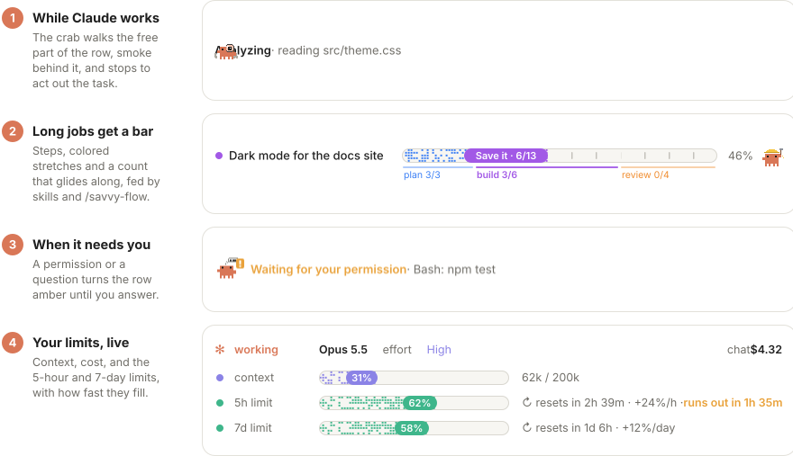
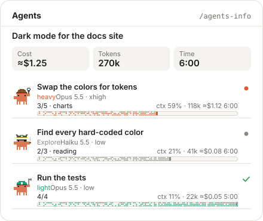

<p align="center">
  <picture>
    <source media="(prefers-color-scheme: dark)" srcset="assets/hero-dark.svg">
    
  </picture>
</p>

A Claude Code mod that sits right above the prompt and beside the chat:

- **The crab** shows what Claude is doing right now (sleeping, thinking, analyzing, working, coordinating). In the desktop app, while Claude works it walks sideways through the free part of the row, a puff of smoke behind it, and stops to act out the task; asleep it keeps still, and beside the progress bar it sits in the corner. At the right of the row, small: how many actions this answer took so far, and for how long (`12 actions · 1m12s`).
- **Waiting on you**: when Claude asks for a permission or asks you a question, the row turns amber until you answer.
- **A progress bar** for long jobs: a title, the step in progress, stretches with their own colors, and a checklist in the panel. It shows up on its own when Claude writes its task list or you approve a plan, the task at hand on its tag; skills and workflows feed it through the `mcp__crabhud__progress` tool, and subagents report their own steps through `mcp__crabhud__step`. At 100% the crab hops and throws pixel confetti.
- **The HUD** under them: the selected **model** and **effort**, the chat's **context** and **cost**, and the account's **5-hour** and **7-day limits** with their reset times and how fast they fill (`+12%/h`, `+8%/day`), shared across every chat. Compact, each reading is a small ring; expanded, a bar. The pace turns amber, and the expanded HUD says when the limit runs out, when that comes before its reset.
- **The agents panel** (`/agents-info`): running, finished and planned subagents with model, effort, progress, context, cost and time, each with its own crab; and what you spent today and this month, summed over every chat.
- **`/savvy-flow`**: an orchestrated delivery flow. The session model plans, owns the design and reviews; five tiered worker agents (`savvy-fable`, `savvy-heavy`, `savvy-careful`, `savvy-medium`, `savvy-light`) implement. The flow drives the progress bar, and each worker reports its own steps to the panel.

<p align="center">
  <picture>
    <source media="(prefers-color-scheme: dark)" srcset="assets/moments-dark.svg">
    
  </picture>
</p>

<p align="center">
  <picture>
    <source media="(prefers-color-scheme: dark)" srcset="assets/hud-dark.svg">
    
  </picture>
</p>


Switch the HUD between **compact** (one line, a ring per reading) and **expanded** (one row per reading, with its bar, token counts and full reset times): in the desktop app with the ▾/▴ button beside it, in the terminal by clicking anywhere on it. Your choice is remembered. In the app the rings breathe and a glint runs along them, quicker while Claude works; in the terminal they fill in steps, ○ ◔ ◑ ◕ ●.

## The bar, on its own

You don't need a skill to get a progress bar. When Claude writes its own task list, the bar shows one stretch per task, and its tag names the task at hand, cut to a few words (`Adding the dark palette · 2/5`). When you approve a plan, the bar takes its title and its steps until a task list takes over, and the answer that closes the turn completes it. A skill's own bar (`/savvy-flow`, or any skill calling `mcp__crabhud__progress`) always wins over these.

When a bar reaches 100% the crab hops and pixel confetti bursts out in the bar's colours; with sounds on, a short fanfare plays. A bar from the task list or a plan then leaves on its own after 10 seconds; a skill's bar stays until you close it.

## Styles

Seven styles for every bar crabhud draws: the progress bar, the expanded HUD's gauges and the bars in the agents panel. Pick one with `/crabhud style`: a picker with a live preview of each (keys 1–7). The desktop app and the terminal each keep their own pick; `/crabhud style <name>` sets both at once.

<p align="center">
  <picture>
    <source media="(prefers-color-scheme: dark)" srcset="assets/styles-dark.svg">
    
  </picture>
</p>

In the desktop app the bars are drawn shapes: a rounded track with the fill inside it and, on the bigger bars, a tag with the count or the percentage. In the terminal they are text (the expanded HUD's, here):

```
Pixel     ctx ⣦⣿⣀⣀⣀⣀⣀⣀ 31%  │  5h ⣦⣿⣀⣀⣀⣀⣀⣀ 20%  │  7d ⣤⣦⣶⣿⣿⣀⣀⣀ 58%
Segments  ctx ▰▰▱▱▱▱▱▱ 31%  │  5h ▰▰▱▱▱▱▱▱ 20%  │  7d ▰▰▰▰▰▱▱▱ 58%
Line      ctx ━━╸───── 31%  │  5h ━━╸───── 20%  │  7d ━━━━━╸── 58%
Solid     ctx ██░░░░░░ 31%  │  5h ██░░░░░░ 20%  │  7d █████░░░ 58%
Dots      ctx ● ○ ○ ○  31%  │  5h ◐ ○ ○ ○  20%  │  7d ● ● ○ ○  58%
Spark     ctx ▅█▁▁▁▁▁▁ 31%  │  5h ▅█▁▁▁▁▁▁ 20%  │  7d ▃▄▅▆█▁▁▁ 58%
Classic   ctx █▒······ 31%  │  5h █▒······ 20%  │  7d ███▓▒··· 58%
```

- **Pixel**: pixels that thicken toward the head and twinkle (braille dots in the terminal).
- **Segments**: a block per step. **Dots**: a dot per step. Both count the real steps of the progress bar when they fit.
- **Line**: a thin line with a glowing head. **Solid**: a filled bar with a light that sweeps along it while Claude works (drawn above with █ and ░). **Spark**: a meter that rises as it fills.
- **Classic**: solid blocks, █ ▓ ▒ and dots after.

The defaults are **Pixel** in the desktop app and **Classic** in the terminal. While Claude works the heads pulse. The Remote Control row draws the same style, without the animation.

The loudest settings get their own look, following each surface's own effort picker:

- **Desktop app:** **Ultracode** switches palettes: the bars flow through a purple-to-pink gradient and a soft pixel wave drifts behind everything.
- **Terminal:** Low is yellow, Medium green, High purple. **xhigh** turns the HUD purple, with a purple wave behind it; **max** turns it every colour, with a rainbow wave. Ultracode (Tab in `/effort`, `/effort ultracode on`, or `"ultracode": true` in the settings) shows next to the level, as in `Max · Ultracode`; "Dynamic workflows" in `/config` only allows it, so it does not turn it on.

When the context or a limit crosses 90%, you get a toast.

## The agents panel

<p align="center">
  <picture>
    <source media="(prefers-color-scheme: dark)" srcset="assets/panel-dark.svg">
    
  </picture>
</p>

`/agents-info` opens it beside the chat. Each subagent gets a card with its crab, its model and effort, the steps it reports, its context, cost and time; the cards stay after they finish, with a check, and the header adds them up. Under the header, one line: this answer's actions and time at the left, and at the right what you spent today and this month, summed over every chat on the machine (only there, not in the HUD). The sums start counting the day crabhud 2.6 is installed, and keep about two months.

## Portraits of your own agents

In the agents panel the savvy workers and Explore wear costumes of their own; any other agent is the plain crab. To dress your team's agents, put a `crabhud-portraits.json` in a folder under `~/.claude/mods/` (a repository of your team's, say). crabhud reads every one it finds there when a chat opens:

```json
{
  "crabhud": 1,
  "groups": { "prep": "#E46FB0" },
  "portraits": {
    "barista": {
      "agents": ["barista-team"],
      "color": "#8B5A2B",
      "pixels": [
        [7, 10, 16, 12, "#D97757"],
        [7, 22, 2, 4, "#D97757", "la"],
        [22, 14, 4, 5, "role", "fr cup"]
      ],
      "css": [".la,.lb{animation:none}", ".cup{animation:blink 1s steps(1) infinite}"]
    }
  }
}
```

- `agents`: the agent types it dresses, as the Agent tool names them. `color`: the agent's colour in the panel.
- `pixels`: the crab on its 30×26 grid, one rectangle each (`x, y, width, height, colour, class`). `role` paints in the agent's colour. The classes `la` and `lb` are the legs (they step while it runs), `fr` draws in front of them, and any other class names a part for `css` to move.
- `css`: its motion while it runs. Each rule is scoped to the portrait (`.cup{…}` moves only its `cup`), and `@keyframes` of its own are welcome; crabhud's `blink`, `c1`–`c3` and `peek` are there to use.
- `groups`: a progress bar group's colour by its name, kept whichever groups a skill calls.

A name the mod already uses (the tiers, `explore`) can't be replaced, and what doesn't hold (a colour that isn't one, a rule that could reach outside the drawing) is left out; crabhud says so once when the chat opens.

## Remote Control

Following a chat through Remote Control (from the phone or another computer), the HUD shows a still version of the compact row, marked **⇄ Remote Control: ON**: the same model, effort, context, limits and cost, in the same colours, refreshed with every new reading, without the animations (each frame would have to cross the connection). The computer running the chat keeps the full HUD. The mod only needs to be installed on that computer.

## How it stays live

- **Context and cost** refresh after every model response, not only when a turn ends.
- **Model and effort** follow the picker under the chat the moment you change it (desktop app). In the terminal they follow `/effort` the moment it closes, and start from the effort saved for your model.
- **Limits** are the account's, not the chat's: every chat running the HUD shares its latest reading through a small file (`~/.claude/crabhud-limits.json`), and every HUD shows the freshest one. Use one chat to 97% and the others show 97% within half a second.
- A window whose reset time has passed drops back to 0% until the next reading.

## Install

Works in the Claude desktop app (Code tab) and in the Claude Code terminal, on Windows, macOS, and Linux. On Linux the HUD reads the app's records from `$XDG_CONFIG_HOME` (or `~/.config`), and in the terminal it works the same as anywhere else.

1. Clone the repository into your mods folder:

   ```bash
   git clone https://github.com/vinicius-sandes/crabhud ~/.claude/mods/crabhud
   ```

2. Add this to `~/.claude/settings.json` (inside the existing top-level object):

   ```json
   "env": { "CLAUDE_CODE_PLUGIN_DIRS": "~/.claude/mods/crabhud" }
   ```

   If your `settings.json` already has an `"env"` block, add just the `CLAUDE_CODE_PLUGIN_DIRS` key to it.

3. Open a new chat. The HUD appears above the prompt, in every chat from now on, and asks which language you want.

To update: `git -C ~/.claude/mods/crabhud pull`, then open a new chat.

## Language

The HUD speaks English by default and also Brazilian Portuguese. The first time it appears, it asks which one you want, once. Your pick is kept for every chat on that machine, and the progress bar and the agents panel follow it too. Change it anytime with `/crabhud language`.

To skip the question (for example, when setting up a machine from a script), set it in `~/.claude/settings.json`:

```json
"pluginConfigs": { "crabhud": { "options": { "language": "pt-BR" } } }
```

## Commands

- `/crabhud off` hides the HUD, `/crabhud on` shows it again, `/crabhud` toggles it.
- `/crabhud language` asks for the language again; `/crabhud language en` or `/crabhud language pt-BR` sets it directly.
- `/crabhud style` opens the style picker; `/crabhud style pixel|segments|line|solid|dots|spark|classic` sets it directly.
- `/crabhud status` sums it all up as text: model and effort, context, the limits with their reset and pace, this chat's, today's and this month's spend, the bar, the agents and your settings.
- `/crabhud demo` plays 20 seconds of sample data (a bar walking to its celebration, two agents, the amber wait, sample limits when there's no reading yet) and then puts everything back as it was; `/crabhud demo off` stops it.
- `/crabhud sound on` plays a short chime when Claude waits for you and when it finishes, and a little fanfare when a bar reaches 100%; `/crabhud sound off` silences it (the default). The clips are the mod's own (`sounds/`); macOS plays them, a Windows or Linux terminal has no player and stays quiet.
- `/agents-info` opens or closes the agents panel.
- `/savvy-flow <task>` (`/crabhud:savvy-flow` when another skill has the same name) runs the orchestrated flow.

## Cost

The HUD never calls the model and adds nothing to what is sent to Claude: it spends no tokens and does not touch your limits. It only uses a little of your own machine: a file check every quarter second (the chat's settings and the shared limits), a local usage read every second, redraws while Claude is working or Ultracode is on, and in the desktop app a redraw every 30 seconds for the reset countdowns (its animations run in the drawing itself).

## Privacy

Everything stays on your machine. The HUD reads the desktop app's local record of the current chat (only its model and effort fields) and writes one small file with your limit percentages and reset times; the day-by-day spend sits in the mod's own local store. Nothing is sent anywhere.

## Notes

- Claude Code's mod system (function hooks) is in early access and may change between releases.
- The 5-hour and 7-day limits appear after the first response in any chat running the HUD.

## Tests

```bash
claude plugin validate ~/.claude/mods/crabhud
claude plugin test ~/.claude/mods/crabhud
```

## License

[MIT](LICENSE). The progress bar, the crab, the agents panel and `/savvy-flow` start from JohnnyVizz's [claude-kit](https://github.com/JohnnyVizz/claude-kit), and the bar styles follow nvr0x5's [claude-deck](https://github.com/nvr0x5/claude-deck) (both MIT); see [THIRD_PARTY_NOTICES.md](THIRD_PARTY_NOTICES.md).
