<p align="center">
  <picture>
    <source media="(prefers-color-scheme: dark)" srcset="assets/hero-dark.svg">
    
  </picture>
</p>

<p align="center">
  <a href="CHANGELOG.md"></a>
  <a href="LICENSE"></a>
  
</p>

crabhud is a Claude Code mod that shows, without leaving the chat, what Claude is doing, how far a long job has gone and how much of your limits is left. It sits right above the prompt and beside the chat:

- A crab shows what Claude is doing right now: sleeping, thinking, analyzing, working or coordinating. In the desktop app it walks sideways through the free part of the row while Claude works, a puff of smoke behind it, and stops to act out the task. Asleep, it keeps still; next to the progress bar, it sits in the corner. At the right of the row, in small type, is how many actions this answer has taken so far and for how long (`12 actions · 1m12s`).
- When Claude asks for a permission or asks you a question, the row turns amber until you answer.
- Long jobs get a progress bar with a title, the step in progress, stretches in their own colors and a checklist in the panel. It appears on its own when Claude writes its task list or you approve a plan, with the task at hand on its tag. Skills and workflows feed it through the `mcp__crabhud__progress` tool, and subagents report their own steps through `mcp__crabhud__step`. At 100% the crab hops and throws pixel confetti.
- Under them, the HUD shows the selected model and effort, the chat's context and cost, and the account's 5-hour and 7-day limits with their reset times and how fast they fill (`+12%/h`, `+8%/day`), shared across every chat. In the compact HUD each reading is a small ring; in the expanded one, a bar. When a limit is on pace to run out before it resets, the pace turns amber and the expanded HUD says when it will run out.
- The agents panel (`/agents-info`) lists running, finished and planned subagents with their model, effort, progress, context, cost and time, each with its own crab, plus what you spent today and this month over every chat.
- `/crab-flow` runs an orchestrated delivery flow. The session model plans, owns the design and reviews, and five tiered worker agents (`crab-fable`, `crab-heavy`, `crab-careful`, `crab-medium`, `crab-light`) implement. The flow drives the progress bar, and each worker reports its own steps to the panel.

<p align="center">
  <picture>
    <source media="(prefers-color-scheme: dark)" srcset="assets/moments-dark.svg">
    
  </picture>
</p>

<p align="center">
  <picture>
    <source media="(prefers-color-scheme: dark)" srcset="assets/hud-dark.svg">
    
  </picture>
</p>

The HUD has two sizes. Compact is one line with a ring per reading; expanded gives each reading its own row, with its bar, token counts and full reset times. In the desktop app you switch with the ▾/▴ button beside it, and in the terminal by clicking anywhere on it. crabhud remembers your choice. In the app the rings breathe and a glint runs along them, faster while Claude works; in the terminal they fill in steps, ○ ◔ ◑ ◕ ●.

When the compact row is too narrow for the reset times, the cost and the 5-hour reset take turns, ten seconds each (`$4.32` ↔ `5h ↻ 2h39m`). The expanded HUD ends with what you spent today and this month over every chat. Set a budget with `/crabhud budget 10` and the chat's cost turns amber once it passes $10.

## The bar, on its own

You don't need a skill to get a progress bar. When Claude writes its own task list, the bar shows one stretch per task, and its tag names the task at hand in a few words (`Adding the dark palette · 2/5`). When you approve a plan, the bar takes the plan's title and steps until a task list takes over, and the answer that closes the turn completes it. A skill's own bar (`/crab-flow`, or any skill calling `mcp__crabhud__progress`) always wins over these.

When a bar reaches 100% the crab hops and pixel confetti bursts out in the bar's colours, and with sounds on, a short fanfare plays. A bar from the task list or a plan leaves on its own 10 seconds later; a skill's bar stays until you close it.

## Styles

crabhud draws every bar (the progress bar, the expanded HUD's gauges and the bars in the agents panel) in one of twelve styles. `/crabhud style` opens a picker with a live preview of each, on keys 1 to 9 and then a, b and c. The desktop app and the terminal each keep their own pick, and `/crabhud style <name>` sets both at once.

<p align="center">
  <picture>
    <source media="(prefers-color-scheme: dark)" srcset="assets/styles-dark.svg">
    
  </picture>
</p>

In the desktop app the bars are drawn shapes: a rounded track with the fill inside it and, on the bigger bars, a tag with the count or the percentage. In the terminal they are text. Here is the expanded HUD in each style:

```
Pixel     ctx ⣦⣿⣀⣀⣀⣀⣀⣀ 31%  │  5h ⣦⣿⣀⣀⣀⣀⣀⣀ 20%  │  7d ⣤⣦⣶⣿⣿⣀⣀⣀ 58%
Segments  ctx ▰▰▱▱▱▱▱▱ 31%  │  5h ▰▰▱▱▱▱▱▱ 20%  │  7d ▰▰▰▰▰▱▱▱ 58%
Line      ctx ━━╸───── 31%  │  5h ━━╸───── 20%  │  7d ━━━━━╸── 58%
Solid     ctx ██░░░░░░ 31%  │  5h ██░░░░░░ 20%  │  7d █████░░░ 58%
Dots      ctx ● ○ ○ ○  31%  │  5h ◐ ○ ○ ○  20%  │  7d ● ● ○ ○  58%
Spark     ctx ▅█▁▁▁▁▁▁ 31%  │  5h ▅█▁▁▁▁▁▁ 20%  │  7d ▃▄▅▆█▁▁▁ 58%
Classic   ctx █▒······ 31%  │  5h █▒······ 20%  │  7d ███▓▒··· 58%
Wave      ctx ≈≋······ 31%  │  5h ≈≋······ 20%  │  7d ≈≋≈~≈··· 58%
Stripes   ctx ▞▞░░░░░░ 31%  │  5h ▞▞░░░░░░ 20%  │  7d ▞▞▞▞▞░░░ 58%
Neon      ctx ━━●┄┄┄┄┄ 31%  │  5h ━━●┄┄┄┄┄ 20%  │  7d ━━━━━●┄┄ 58%
Glass     ctx ▄▄░░░░░░ 31%  │  5h ▄▄░░░░░░ 20%  │  7d ▄▄▄▄▄░░░ 58%
Stairs    ctx ▃▃······ 31%  │  5h ▃▃······ 20%  │  7d ▃▃▃▅▅··· 58%
```

- Pixel: pixels that thicken toward the head and twinkle (braille dots in the terminal).
- Segments and Dots: a block or a dot per step. Both count the progress bar's real steps when they fit.
- Line: a thin line with a glowing head.
- Solid: a filled bar with a light that sweeps along it while Claude works (█ and ░ in the terminal).
- Spark: a meter that rises as it fills.
- Classic: solid blocks, █ ▓ ▒, with dots after them.
- Wave: liquid in a tube, its surface rolling while Claude works.
- Stripes: diagonal stripes that slide along, like a barber's pole.
- Neon: a glowing tube with the percentage on a dark tag.
- Glass: a glossy bar with a highlight and a light that sweeps along it (▄ and ░ in the terminal).
- Stairs: blocks that climb in three steps as the bar fills, with the steps still to climb dimmed (dots in the terminal).

The defaults are Pixel in the desktop app and Classic in the terminal. While Claude works, the heads pulse. The Remote Control row draws the same style without the animation.

The loudest effort settings get their own look, following each surface's effort picker:

- In the desktop app, Ultracode switches palettes: the bars flow through a purple-to-pink gradient and a soft pixel wave drifts behind everything.
- In the terminal, Low is yellow, Medium green and High purple. xhigh turns the HUD purple with a purple wave behind it, and max turns it every colour with a rainbow wave. Ultracode (Tab in `/effort`, `/effort ultracode on`, or `"ultracode": true` in the settings) shows next to the level, as in `Max · Ultracode`. "Dynamic workflows" in `/config` only allows Ultracode; it doesn't turn it on.

When the context or a limit crosses 90%, you get a toast.

## The theme

`/crabhud theme on` dresses the whole desktop app, and `/crabhud theme off` gives the app its own look back. It is off until you turn it on, and the choice carries over to later chats. Two choices shape it, both in the `/crabhud style` picker:

- **The style** picks the backdrop and how clear the glass is. Each of the twelve styles has its own scene behind the chat, with crabs walking across it: a pixel reef, a city of rounded towers, a horizon with sailboats, bold dunes, constellations, a starry night, an old terminal, waves and a lighthouse, a striped beach, a synthwave sun, bubbles and lenses, stepped pyramids. The middle stays calm, where the words are.
- **The palette** picks the colors of the app (the left sidebar too) and of the scene: Claude (orange, the default), Mint on black, Ocean, Violet, Rose, Amber, Lagoon, Neon, Ice and Graphite. `/crabhud palette <name>` picks one too.

The app frosts its panels over the backdrop, and the glass is see-through in every style: the clearest in Glass, the least in Solid and Classic. The agents panel's cards, the progress row and the HUD take the palette's tones. The backdrop holds still while Claude works, so it never blinks; only what is drawn in it moves.

The theme shows in the desktop and mobile apps; the terminal keeps its own colors. It needs a Claude Code with themes (the desktop app's 2.1.325 has them). Only one theme shows at a time, so turning on the crabhud theme replaces another mod's theme, and `/crabhud theme off` clears the theme the app is showing.

## The agents panel

<p align="center">
  <picture>
    <source media="(prefers-color-scheme: dark)" srcset="assets/panel-dark.svg">
    
  </picture>
</p>

`/agents-info` opens the panel beside the chat. Each subagent gets a card with its crab, model and effort, the steps it reports, and its context, cost and time. Cards stay after they finish, marked with a check, and the header adds them up. A minute after an agent finishes well, its card shrinks to one line with its crab, name, cost, time and check; a card that failed stays full size. Under the header, one line shows this answer's actions and time on the left and, on the right, what you spent today and this month over every chat on the machine (the expanded HUD shows it too). The sums start counting on the day you install crabhud 2.6 or later and keep about two months.

Each kind of agent has its own clothes. The crab-flow workers, Explore and Plan wear these, and any other agent wears the handyman's overalls:

<p align="center">
  <picture>
    <source media="(prefers-color-scheme: dark)" srcset="assets/crew-dark.svg">
    
  </picture>
</p>

## Portraits of your own agents

To dress your team's agents, put a `crabhud-portraits.json` in a folder under `~/.claude/mods/` (your team's repository, for example). crabhud reads every one it finds there when a chat opens:

```json
{
  "crabhud": 1,
  "groups": { "prep": "#E46FB0" },
  "portraits": {
    "barista": {
      "agents": ["barista-team"],
      "color": "#8B5A2B",
      "pixels": [
        [7, 10, 16, 12, "#D97757"],
        [7, 22, 2, 4, "#D97757", "la"],
        [22, 14, 4, 5, "role", "fr cup"]
      ],
      "css": [".la,.lb{animation:none}", ".cup{animation:blink 1s steps(1) infinite}"]
    }
  }
}
```

- `agents` lists the agent types the portrait dresses, as the Agent tool names them, and `color` is the agent's colour in the panel.
- `pixels` draws the crab on its 30×26 grid, one rectangle each (`x, y, width, height, colour, class`). `role` paints in the agent's colour. The classes `la` and `lb` are the legs, which step while the agent runs, and `fr` draws in front of them. Any other class names a part for `css` to move.
- `css` is the portrait's motion while the agent runs. Each rule is scoped to the portrait (`.cup{…}` moves only its `cup`), and you can add `@keyframes` of your own. crabhud's `blink`, `c1` to `c3` and `peek` are there to use.
- `groups` sets a progress bar group's colour by its name, whichever skill calls that group.

You can't replace a name the mod already uses (the tiers, `explore`). crabhud leaves out anything that doesn't hold, such as a colour that isn't one or a rule that could reach outside the drawing, and says so once when the chat opens.

## Remote Control

When you follow a chat through Remote Control, from your phone or another computer, the HUD shows a still version of the compact row marked **⇄ Remote Control: ON**. It has the same model, effort, context, limits and cost in the same colours and refreshes with every new reading, but has no animations, since each frame would have to cross the connection. The computer running the chat keeps the full HUD, and the mod only needs to be installed on that computer.

## How it stays live

- Context and cost refresh after every model response, not only when a turn ends.
- In the desktop app, model and effort follow the picker under the chat the moment you change it. In the terminal they follow `/effort` as soon as it closes, starting from the effort saved for your model.
- Limits belong to the account, not the chat. Every chat running the HUD shares its latest reading through a small file (`~/.claude/crabhud-limits.json`), and every HUD shows the freshest one. If you take one chat to 97%, the others show 97% within half a second.
- A window whose reset time has passed drops back to 0% until the next reading.

## Install

crabhud works in the Claude desktop app (Code tab) and in the Claude Code terminal, on Windows, macOS and Linux. On Linux the HUD reads the app's records from `$XDG_CONFIG_HOME` (or `~/.config`); the terminal works as it does everywhere else.

On Claude Code 2.1.275 or later, the quickest way is:

```
/plugin install crabhud --marketplace vinicius-sandes/crabhud
```

Then open a new chat. To install it by hand instead:

1. Clone the repository into your mods folder:

   ```bash
   git clone https://github.com/vinicius-sandes/crabhud ~/.claude/mods/crabhud
   ```

2. Add this to `~/.claude/settings.json`, inside the existing top-level object:

   ```json
   "env": { "CLAUDE_CODE_PLUGIN_DIRS": "~/.claude/mods/crabhud" }
   ```

   If your `settings.json` already has an `"env"` block, add only the `CLAUDE_CODE_PLUGIN_DIRS` key to it.

3. Open a new chat. The HUD appears above the prompt in every chat from then on, and asks which language you want.

To update, run `git -C ~/.claude/mods/crabhud pull` and open a new chat.

## Language

The HUD speaks English by default, and Brazilian Portuguese too. The first time it appears, it asks once which one you want. Your pick applies to every chat on that machine, including the progress bar and the agents panel. Change it any time with `/crabhud language`.

To skip the question, for example when you set up a machine from a script, set the language in `~/.claude/settings.json`:

```json
"pluginConfigs": { "crabhud": { "options": { "language": "pt-BR" } } }
```

## Commands

- `/crabhud off` hides the HUD, `/crabhud on` shows it again, and `/crabhud` toggles it.
- `/crabhud language` asks for the language again; `/crabhud language en` or `/crabhud language pt-BR` sets it directly.
- `/crabhud style` opens the style picker; `/crabhud style pixel|segments|line|solid|dots|spark|classic|wave|stripes|neon|glass|stairs` sets the style directly.
- `/crabhud theme on` dresses the whole desktop app (colors, frosted glass and a backdrop with crabs), and `/crabhud theme off` turns it off, which is the default. `/crabhud palette <name>` picks its colors.
- `/crabhud budget 10` turns this chat's cost amber once it passes $10, and `/crabhud budget off` clears it. The budget carries over to later chats.
- `/crabhud status` sums everything up as text: model and effort, context, the limits with their resets and pace, this chat's, today's and this month's spend, the bar, the agents and your settings.
- `/crabhud demo` plays 20 seconds of sample data (a bar walking to its celebration, two agents, the amber wait, and sample limits when there's no reading yet), then puts everything back as it was. `/crabhud demo off` stops it.
- `/crabhud sound on` plays a short chime when Claude waits for you and when it finishes, and a little fanfare when a bar reaches 100%. `/crabhud sound off` silences it, which is the default. The clips are the mod's own (`sounds/`). macOS plays them; a Windows or Linux terminal has no player and stays quiet.
- `/agents-info` opens or closes the agents panel.
- `/crab-flow <task>` runs the orchestrated flow (use `/crabhud:crab-flow` when another skill has the same name).

## Cost

The HUD never calls the model and adds nothing to what is sent to Claude, so it spends no tokens and doesn't touch your limits. It uses a little of your own machine: a file check every quarter second (the chat's settings and the shared limits), a local usage read every second, redraws while Claude works or Ultracode is on, and, in the desktop app, a redraw every 30 seconds for the reset countdowns. The animations run inside the drawing itself.

## Privacy

Everything stays on your machine. The HUD reads the desktop app's local record of the current chat (only its model and effort fields) and writes one small file with your limit percentages and reset times. The day-by-day spend sits in the mod's own local store. Nothing is sent anywhere.

## Notes

- Claude Code's mod system (function hooks) is in early access and may change between releases.
- The 5-hour and 7-day limits appear after the first response in any chat running the HUD.

## Tests

```bash
claude plugin validate ~/.claude/mods/crabhud
claude plugin test ~/.claude/mods/crabhud
```

## Changelog

[CHANGELOG.md](CHANGELOG.md) lists what changed in each version.

## License

[MIT](LICENSE). The progress bar, the crab, the agents panel and `/crab-flow` start from JohnnyVizz's [claude-kit](https://github.com/JohnnyVizz/claude-kit) (its savvy-progress mod and savvy-flow plugin), and the bar styles follow nvr0x5's [claude-deck](https://github.com/nvr0x5/claude-deck). Both are MIT licensed; see [THIRD_PARTY_NOTICES.md](THIRD_PARTY_NOTICES.md).
